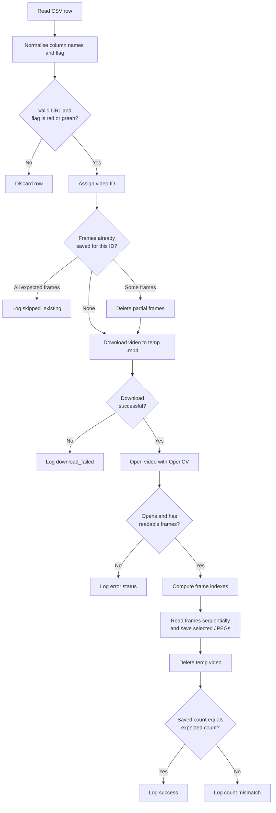
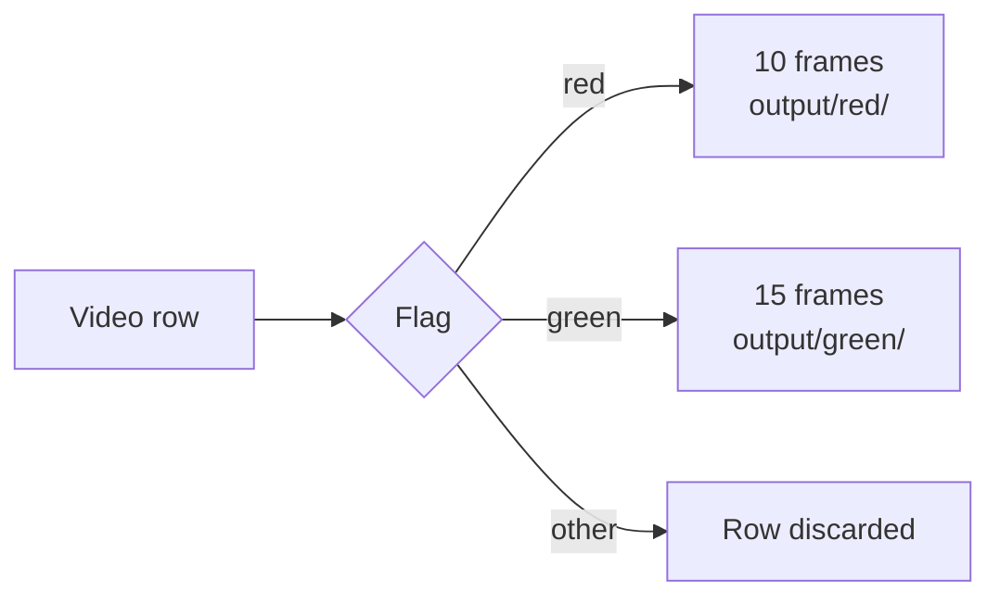

<div align="center">

# Video-to-Frames Dataset Preparation

A command-line tool that downloads videos from a CSV list and extracts evenly spaced frames as JPEG images, organised into folders by category.


</div>

## Table of Contents

1. [Overview](#overview)
2. [Workflow](#workflow)
3. [Quick Start](#quick-start)
4. [Input Format](#input-format)
5. [Flag Values and Frame Counts](#flag-values-and-frame-counts)
6. [Frame Selection](#frame-selection)
7. [Output](#output)
8. [Resume Behaviour](#resume-behaviour)
9. [Usage](#usage)
10. [Error Handling](#error-handling)
11. [Project Structure](#project-structure)
12. [Limitations](#limitations)
13. [Future Work](#future-work)
14. [License](#license)

## Overview

This script automates video retrieval and frame extraction for dataset preparation. It reads a CSV file of video URLs, downloads each video to a temporary file, saves a fixed number of evenly spaced frames as JPEG images, and then deletes the video. Frames are written to separate folders according to a per-video category flag, and every video's result is recorded in a processing log.

Key characteristics:

- Evenly spaced frame sampling from the first to the last frame.
- Category-specific frame counts (`red` and `green`).
- Resumable runs: completed videos are skipped, partial ones are redone.
- Per-video error handling, so a single failure does not stop the run.
- A processing log and an end-of-run summary of expected versus actual frame counts.

## Workflow

### Pipeline overview


### Per-video processing logic



### Flag routing



## Quick Start

```bash
python -m venv .venv
source .venv/bin/activate        # Windows: .venv\Scripts\activate
pip install -r requirements.txt
python src/extract_frames.py --input path/to/videos.csv --output output
```

Requires Python 3.9 or newer.

## Input Format

A CSV file with two columns. Column names are matched ignoring case, spacing, and punctuation, so `Video URL`, `video_url`, and `VIDEO URL` are all accepted.

| Column | Description |
|---|---|
| `Video URL` | Direct HTTP(S) link to a video file |
| `Flag` | Category of the video: `Red` or `Green` |

Placeholder example:

```csv
Video URL,Flag
https://example.com/path/video_a.mp4,Red
https://example.com/path/video_b.mp4,Green
```

Rows are ignored if the flag is not `red` or `green` (case-insensitive) or if the URL is empty. UTF-8 files are expected, with `latin1` as a fallback if decoding fails.

## Flag Values and Frame Counts

The flag determines how many frames are extracted from each video and which folder they are saved in.

| Flag | Default frames per video | Output folder |
|---|---:|---|
| `red` | 10 | `output/red/` |
| `green` | 15 | `output/green/` |

The counts can be changed with `--red-frames` and `--green-frames`. Both must be integers greater than 0.

## Frame Selection

Frames are evenly spaced from the first to the last frame of the video. For a video with `N` frames and `K` requested frames, the frame indexes are:

```text
index(i) = round(i * (N - 1) / (K - 1)),   for i = 0 ... K-1
```

Consecutive duplicate indexes are removed. If a video has fewer than `K` frames, all of its frames are used. The video is read once, sequentially, and the selected frames are written as JPEG files.

**Worked example:** a video with `N = 100` frames and `K = 10` requested frames.

| i | 0 | 1 | 2 | 3 | 4 | 5 | 6 | 7 | 8 | 9 |
|---|---|---|---|---|---|---|---|---|---|---|
| Frame index | 0 | 11 | 22 | 33 | 44 | 55 | 66 | 77 | 88 | 99 |

## Output

```text
output/
├── red/
│   ├── video_000001_frame_01.jpg
│   └── ...
├── green/
│   ├── video_000002_frame_01.jpg
│   └── ...
└── processing_log.csv
```

- Frame files are named `video_NNNNNN_frame_NN.jpg`.
- `video_NNNNNN` is the video's 1-based position among the valid rows of the CSV.
- Videos are downloaded to a temporary `.mp4` file (streamed in 1 MB chunks with `requests`), processed, and then deleted. They are not kept.

### Processing log

`processing_log.csv` contains one row per video.

| Column | Description |
|---|---|
| `video_id` | 1-based position among valid CSV rows |
| `flag` | `red` or `green` |
| `status` | Result of processing (see [Error Handling](#error-handling)) |
| `frames_saved` | Number of frames written |
| `video_frames` | Frame count from video metadata |
| `fps` | Frame rate from video metadata |
| `duration_seconds` | Video duration |
| `video_url` | Source URL |

Some columns are empty for skipped or failed videos. The log contains the processed URLs and should not be published.

## Resume Behaviour

Before processing a video, the script checks for existing frames named after its video ID:

- If the full expected number of frames exists, the video is skipped (`skipped_existing`).
- If only some frames exist, they are deleted and the video is processed again.

## Usage

```bash
python src/extract_frames.py --input path/to/videos.csv --output output
```

### Options

| Option | Default | Description |
|---|---|---|
| `--input` | (required) | Path to the input CSV file |
| `--output` | `output` | Output directory |
| `--red-frames` | `10` | Frames per `red` video (integer > 0) |
| `--green-frames` | `15` | Frames per `green` video (integer > 0) |
| `--flag-column` | `Flag` | Name of the flag column |
| `--url-column` | `Video URL` | Name of the video URL column |

Run `python src/extract_frames.py --help` for the same list.

### Example with custom settings

```bash
python src/extract_frames.py \
  --input data/videos.csv \
  --output dataset_frames \
  --red-frames 20 \
  --green-frames 30
```

## Error Handling

Errors are handled per video, so one failure does not stop the run.

| Status | Meaning |
|---|---|
| `success` | All expected frames were saved |
| `skipped_existing` | Expected frames already existed |
| `download_failed` | The video could not be downloaded |
| `Could not open video` | OpenCV could not open the downloaded file |
| `Video contains no readable frames` | The file opened but no frames could be read |
| `Expected X frames but saved Y` | Frame count differs from the expectation |
| `processing_error: <message>` | Unexpected error during processing |

At the end of the run, the script prints expected versus actual frame counts for each category. A missing input file, missing columns, or invalid frame counts stop the script with an error message.

## Project Structure

```text
.
├── src/
│   └── extract_frames.py
├── requirements.txt
├── LICENSE
└── README.md
```

The `output/` directory is created at run time and is not part of the repository.

## Limitations

- Videos must be downloadable with a plain HTTP(S) request. Authentication is not supported.
- Videos are processed one at a time.
- The frame count is read from video metadata, which can be inaccurate for some files. Such videos are logged as `Expected X frames but saved Y`.
- The expected-frame total assumes each video has enough frames, so very short videos show `CHECK` in the final summary.
- Video IDs depend on row order. Reordering or editing the CSV between runs changes the IDs and affects resuming.
- The final frame count includes every `.jpg` in the output folders, including files from earlier runs.

## Future Work

- Parallel downloads and extraction.
- Support for authenticated or signed URLs.
- Stable video IDs derived from the URL rather than row order.
- Configurable additional categories beyond `red` and `green`.
- Optional output image size and JPEG quality settings.

## License

Specify the project license here and add the corresponding `LICENSE` file to the repository root.
